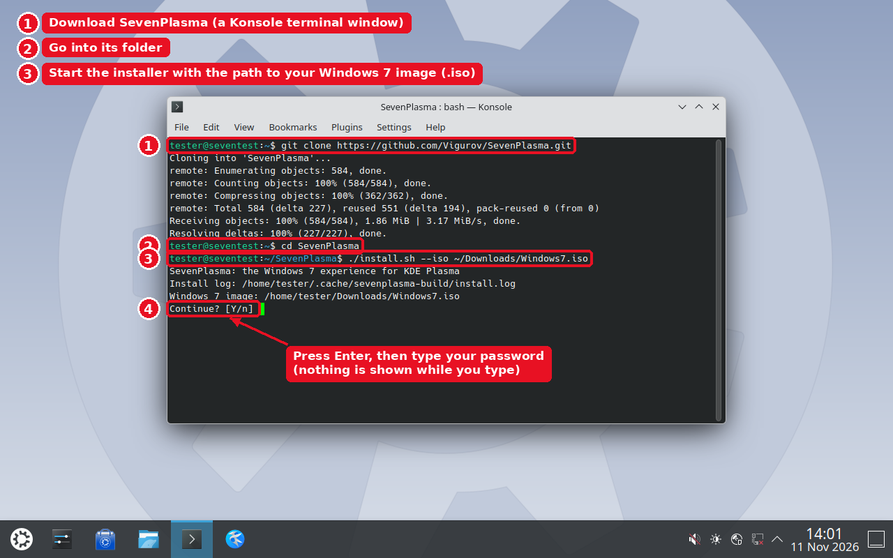
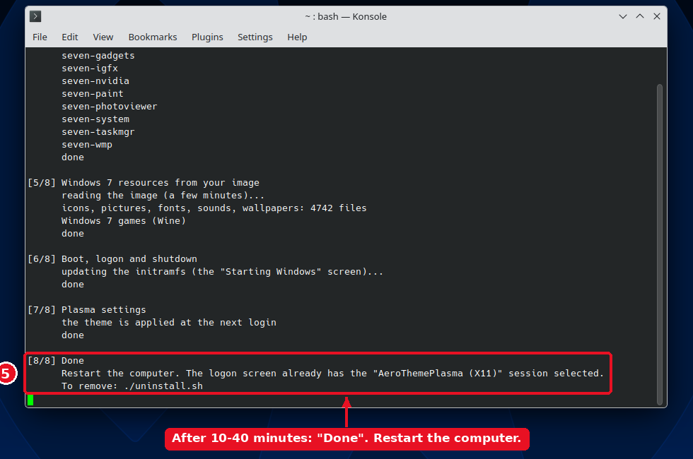
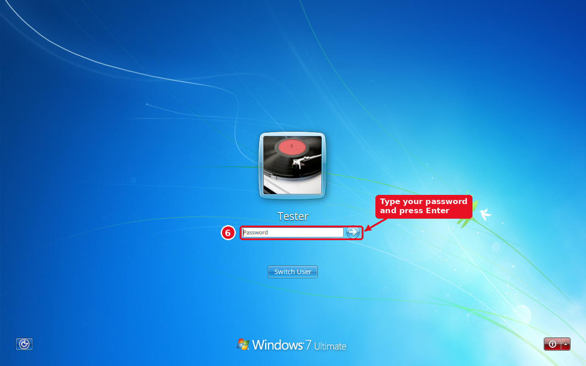
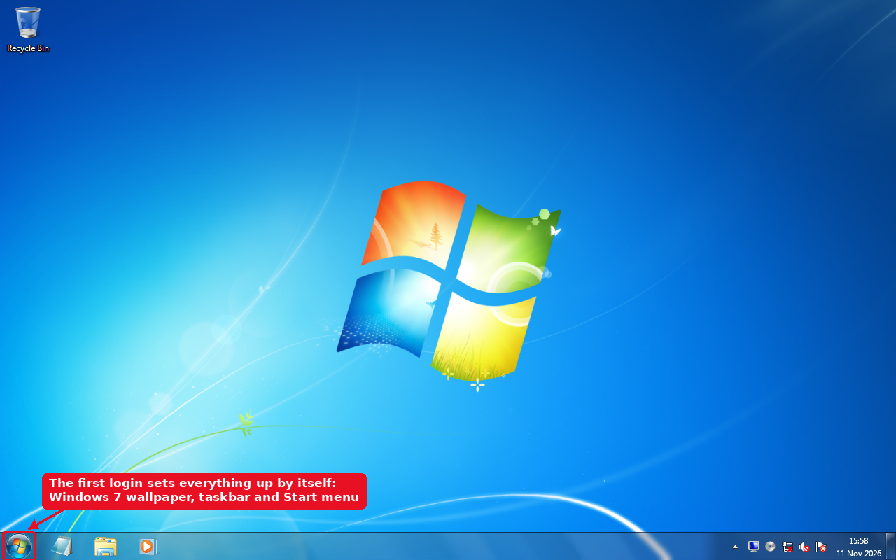
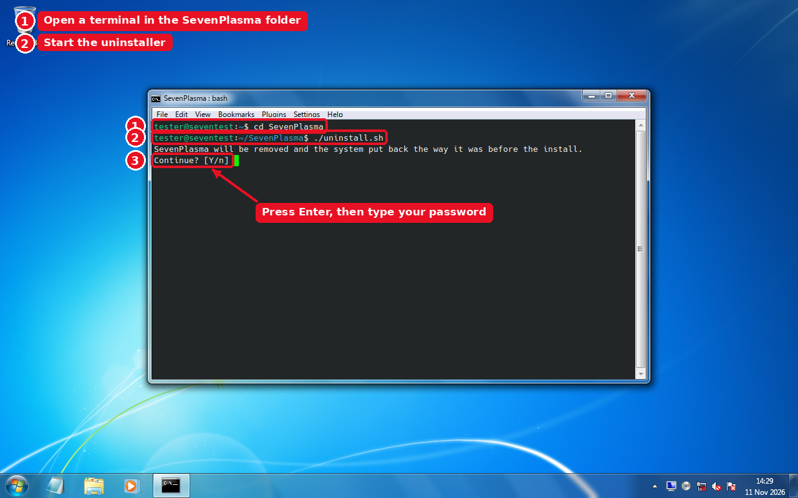
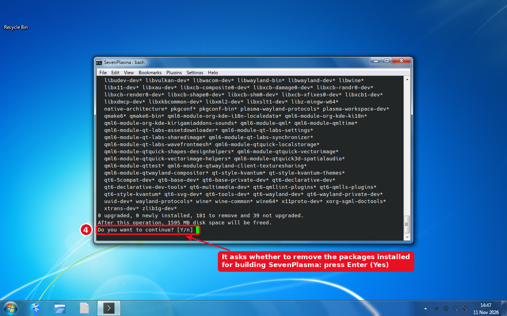
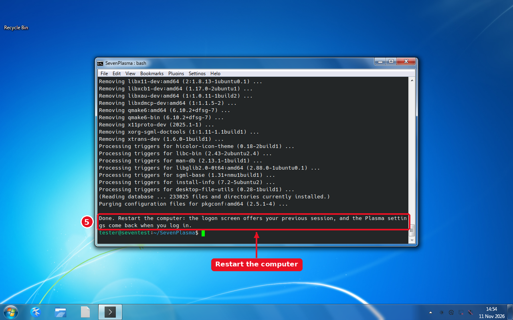
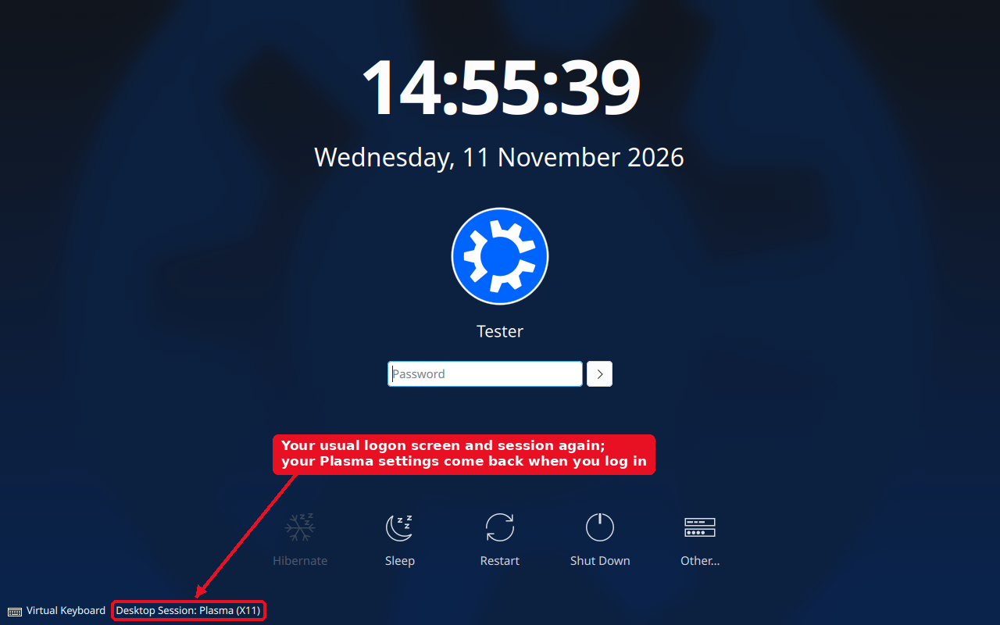

# SevenPlasma

**The Windows 7 look and programs for KDE Plasma 6**

> Early test release 0.1. Bug reports are welcome in [Issues](https://github.com/Vigurov/SevenPlasma/issues).

SevenPlasma turns KDE Plasma into Windows 7. It changes the look and also brings the programs: a Control Panel
with dozens of pages, Explorer, Paint, Windows Media Player, Calculator, Snipping Tool, gadgets, Task Manager,
Computer Management, the boot, logon and shutdown screens, and the Windows 7 games.

The project is built on the excellent [AeroThemePlasma](https://gitgud.io/wackyideas/aerothemeplasma) by
**wackyideas** and the AeroShell contributors. The shell, taskbar, Start menu, window frames (SMOD), Aero
effects, logon screen and UAC are their work. SevenPlasma adds its own changes and programs on top.

## What is included

| | |
|---|---|
| **Shell** | AeroThemePlasma with changes: Start menu, taskbar, tray, tooltips, desktop, logon and lock screens (including accounts without a password, as in Windows 7) |
| **Explorer** | Dolphin and KIO with changes: command bar, libraries, address bar, Open / Save dialogs, Properties, Open with, folder thumbnails |
| **Control Panel** | sound, volume mixer, display, personalization, network, firewall, Windows Update (apt), Action Center, user accounts, backup, fonts, indexing, accessibility, performance and the Experience Index, devices and printers… |
| **Administrative tools** | Computer Management, Event Viewer, Disk Management, Windows Firewall with Advanced Security, Device Manager, Task Manager, Resource Monitor |
| **Accessories** | Calculator, Notepad, Paint, Snipping Tool, Character Map, Photo Viewer, Windows Media Player 12, gadgets, Run |
| **Graphics cards** | NVIDIA Control Panel, AMD Catalyst Control Center, Intel HD Graphics, depending on your graphics card |
| **Boot** | "Starting Windows", "Welcome", "Shutting down…" |
| **Games** | Minesweeper, Solitaire, Spider Solitaire, Chess, Mahjong, Purble Place and more, from your Windows 7 image via Wine |

## Why a Windows 7 image is needed

SevenPlasma contains **no Microsoft files**, only code. Icons, sounds, the Segoe UI fonts, wallpapers, the boot
animation, program pictures and the games are extracted **on your computer from your own copy of Windows 7**
(`install.wim` in the ISO), following the recipes in `extract/recipes.json`. Without an image the theme still
installs, with AeroThemePlasma's icons and sounds and the free Selawik font, but without the games.

## Where to get a Windows 7 image

Microsoft no longer offers Windows 7 for download (support ended in 2020), and SevenPlasma does not link to
copies of it. Use one you are entitled to:

- **your own Windows 7 disc** (retail box or the one that came with a computer); make an ISO of it, e.g.
  `dd if=/dev/sr0 of=Windows7.iso`;
- **a Microsoft subscription** of your work or school (MSDN / Visual Studio), where Windows 7 images are often
  still available.

Windows is not installed or activated: no product key is needed, only the files in the image are read. Any
edition, language and architecture works (tested with 64-bit Ultimate and 32-bit Professional SP1, which give
the same result). Without an image SevenPlasma installs with free replacements and without the games.

## Installation

Two systems are supported, tested on clean installs:

- **Kubuntu 26.04** (Plasma 6.6, X11 session): everything described here;
- **Arch Linux** (Plasma 6.8, Wayland session; Plasma 6.8 has no X11 session): early support, see
  [Known limitations](#known-limitations).

You need your Windows 7 image (`.iso`, see above) and an internet connection. The steps are the same on both
(the pictures are from Kubuntu).

**1.** Open a terminal (**Konsole**, in the application menu) and type these commands, pressing Enter after each:

```bash
git clone https://github.com/Vigurov/SevenPlasma.git
cd SevenPlasma
./install.sh --iso ~/Downloads/Windows7.iso
```

Instead of `~/Downloads/Windows7.iso` write where your image is. When the installer asks
`Continue? [Y/n]`, press Enter, then type your password (the terminal shows nothing while you type it).



**2.** The installer installs packages, builds AeroThemePlasma, the patched Dolphin / KIO / Kvantum and the
programs, and takes the Windows 7 resources from your image. This takes **10–40 minutes**. When it says
`Done`, restart the computer.



**3.** The logon screen is now the Windows 7 one, with the "AeroThemePlasma (X11)" session already selected.
Type your password and press Enter.



**4.** The first login sets everything up by itself (wallpaper, taskbar, Start menu, effects), with no wizards
or questions.



Options: `--no-games` (no games), `--no-forks` (no patched Dolphin / KIO / Kvantum), `--yes` (no questions).
If the Dolphin / KIO / Kvantum versions on your system differ from the tested ones, those parts are skipped
with a warning. The installer speaks Ukrainian on a Ukrainian system and English otherwise. If it stops
(for example the internet connection dropped), just run `./install.sh` again.

## Removing

`./uninstall.sh` puts the computer back the way it was before the install:

- SevenPlasma's programs, resources and services are removed;
- the files of AeroThemePlasma and of the patched Dolphin / KIO / Kvantum / libplasma are removed, and the
  original packages of your distribution are reinstalled;
- the boot screen, the logon screen and session, the keyboard and account settings are as before;
- your Plasma settings from before the install (theme, panel, wallpaper, shortcuts...) come back at the next
  login. Changes you made to them while SevenPlasma was installed are not kept;
- if you agree, the packages installed only for building SevenPlasma are removed too. Updates of system
  packages the installer brought in stay.

**1.** Open a terminal in the SevenPlasma folder and start the uninstaller. Press Enter to confirm, then type
your password:

```bash
cd SevenPlasma
./uninstall.sh
```



**2.** It asks whether to remove the packages installed for building SevenPlasma, then shows the list:
press Enter both times (or answer `n` to keep them).



**3.** When it says `Done`, restart the computer.



**4.** The logon screen and session are your usual ones again, and your Plasma settings come back when you
log in.



The state from before the install is kept in `~/.local/share/sevenplasma-backup` (made by the first
`install.sh`; installs made with an older version have none, then only SevenPlasma's own files are removed).

## Repository layout

- `apps/` – our programs (Qt 6 / KDE Frameworks 6) and Plasma widgets
- `patches/` – our changes to AeroThemePlasma, Dolphin, KIO, Kvantum and libaero-qt; the versions they apply
  to are listed in `patches/BASES.txt`
- `extract/` – extraction of resources from the Windows 7 image (`seven-extract.py`, `recipes.json`), of the
  Kvantum themes (`kvbuild.py`) and of the boot screen (`plymouth-build.py`)
- `kvantum/` – Kvantum themes without pictures (`kvbuild.py` puts them back)
- `boot/`, `data/` – boot screen, launchers, services, settings
- `tools/` – developer tools (finding the sources of resources in Windows, generating the patches)

## Known limitations

- Plasma 6.6 (Kubuntu 26.04, X11) and Plasma 6.8 (Arch Linux, Wayland) only; other versions and distributions
  are not supported yet.
- On Arch (Plasma 6.8, Wayland), not yet: the Explorer look of Dolphin (the patched Dolphin is made for
  Kubuntu's version and is skipped; the Windows 7 file dialogs and widget style work), the "Starting Windows" boot
  screen (the theme is installed, but Plymouth needs its initramfs hook and the `splash` kernel option, which
  are left to you), and on Wayland the Snipping Tool, On-Screen Keyboard, display pages, screen savers and the
  colour settings of the graphics card panels. The work is tracked in `docs/porting-plasma-6.8.md`.
- A few dozen small interface pictures have no extraction recipe yet (see `extract/TODO-assets.txt`).
- Translations of the programs: English and Ukrainian (the language follows the system, like the display language of
  Windows 7). More languages are welcome: add `apps/<program>/i18n/<lang>.ts` (Qt Linguist) for the programs and
  `apps/seven-common/i18n/sevenplasma/<lang>.po` (gettext) for the shell, Explorer and the file dialogs.

## Credits and licence

[AeroThemePlasma](https://gitgud.io/wackyideas/aerothemeplasma) and the [AeroShell](https://gitgud.io/aeroshell)
repositories (wackyideas, catpswin56 and others), [dolphin-aero and libaero-qt](https://gitgud.io/atmk), KDE,
[Kvantum](https://github.com/tsujan/Kvantum).

SevenPlasma is distributed under the **GNU AGPL-3.0** licence (see `LICENSE`), like AeroThemePlasma.
Microsoft, Windows and Windows 7 are trademarks of Microsoft Corporation; SevenPlasma is not affiliated with
Microsoft. All Windows resources belong to Microsoft and are used only from your own copy of Windows.
